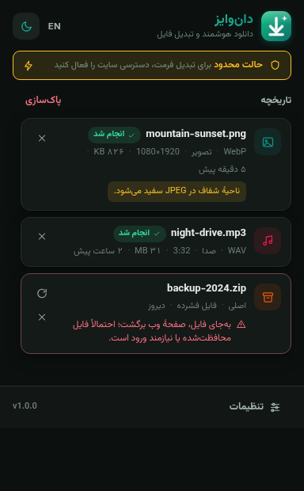

<div align="center">


# دان‌وایز — DownWise

**دانلود هوشمند با کلیک راست و تبدیلِ واقعیِ فرمت فایل برای کروم (Manifest V3).** فارسی / English.

[](https://github.com/SamRonin/downwise/actions/workflows/ci.yml)
[](LICENSE)
[](manifest.json)
[](CONTRIBUTING.fa.md)

🌐 این سند به فارسی است — نسخهٔ انگلیسی را در
[README.md](README.md)
بخوانید.

</div>

---

<div align="center">

| پاپ‌آپ (فارسی · روشن) | تنظیمات (فارسی · روشن) |
|:---:|:---:|
|  |  |
| **پاپ‌آپ (فارسی · تاریک)** | **مجوزها (فارسی · تاریک)** |
|  |  |

*منوی کلیک راست، پیشرفت زندهٔ کارها و تنظیمات فوری — همهٔ‌چیز محلی، همهٔ‌چیز صادقانه.*

</div>

## ✨ ویژگی‌ها

- **منوی هوشمند کلیک راست** — روی هر تصویر، ویدیو، فایل صوتی یا پیوند راست‌کلیک کنید و یکی از
  گزینه‌ها را انتخاب کنید: «دانلود فایل اصلی» (با کاوش هوشمند و شناخت نوع) یا یک هدفِ
  تبدیلِ واقعی («دانلود به فرمت PNG/JPEG/WebP» روی تصاویر، «ذخیرهٔ فریم به صورت
  PNG/JPEG/WebP» روی ویدیوها و «دانلود به فرمت WAV/WebM (Opus)» روی فایل‌های صوتی). منو به زبان
  شماست، با تغییر زبان بی‌درنگ بازسازی می‌شود و می‌توانید کلاً از تنظیمات پنهانش کنید.
- **تبدیل واقعی، بدون فریب** — هر فرمتی که دان‌وایز ارائه می‌دهد، واقعاً با کُدک‌های خود کرومیوم،
  ضبط با MediaRecorder یا کدگذارِ اختصاصی دان‌وایز تولید می‌شود. تغییرِ پسوندِ یک فایل، تبدیل
  نیست؛ دان‌وایز هرگز چنین کاری نمی‌کند.
- **داکیومنت آف‌اسکرینِ خودپاک‌شو** — سندی که صدا را رمزگشایی و فریم ویدیو را استخراج می‌کند، پس
  از ۳۰ ثانیه بی‌کاری خودش بسته می‌شود (هرگز در حین دانلودِ متکی به آن) و همهٔ بافرها، کانوا‌س‌ها و
  AudioContextهای موقت بعد از هر کار آزاد می‌شوند.
- **تشخیص پاسخ HTML و بازیابی هوشمند** — بسیاری از سایت‌ها به‌جای فایل، یک «صفحهٔ وب» برمی‌گردانند
  (محافظ لینک مستقیم یا دیوار ورود). دان‌وایز هر پاسخ را بررسی می‌کند (هم هدرها، هم امضای
  بایت‌ها)، از ذخیرهٔ فایل خراب خودداری می‌کند و سپس در همان صفحه‌ای که کلیک کرده‌اید، نامزدهای
  بهتری برای فایل می‌یابد (ویژگی‌های `data-*` با کیفیت کامل، `srcset`، گونه‌های
  `<picture>/<source>`، `og:image`، `twitter:image` و پیوندهای دانلود مستقیم) و به‌طور خودکار
  دوباره تلاش می‌کند.
- **پیشرفت و وضعیت، همه‌جا** — نوار پیشرفتِ دقیق بر حسب بایت در پاپ‌آپ، نشان‌های وضعیت زنده
  (در صف ← دریافت ← تبدیل ← ذخیره ← انجام شد)، نشان شمارندهٔ کارهای فعال روی آیکون افزونه همراه
  با فلاشِ ✓ و !، و اعلان‌های دسکتاپی که هر وقت بخواهید خاموششان می‌کنید.
- **فارسی و انگلیسی، RTL و LTR** — رابط کاربری دوزبانه با تغییر زبان در همان لحظه (بدون نیاز به
  راه‌اندازی دوبارهٔ مرورگر). فارسی زبان پیش‌فرض است و تایپوگرافی راست‌به‌چپ درجه‌یک با قلم
  وزیرمتن دارد؛ انگلیسی با قلم اینتر. هر دو جهت با «ویژگی‌های منطقی» CSS پیاده شده‌اند، نه
  آینه‌سازی‌های موقتی.
- **پوستهٔ تاریک / روشن / خودکار** — پیروی از سیستم یا قفل کردن روی یک حالت با یک کلیک، در هر دو
  زبان.
- **حریم خصوصی کاملاً محلی** — بدون تحلیلگر، بدون حساب کاربری، بدون تلمتری، بدون کدِ راه‌دور.
  تاریخچهٔ شما در `chrome.storage.local` روی دستگاه خودتان می‌ماند. جزئیات در
  [docs/PRIVACY.md](docs/PRIVACY.md).

## 🎯 چه چیزی به چه چیزی تبدیل می‌شود — صادقانه

[فهرست تبدیل‌ها](src/converters/registry.js) تنها مرجع دان‌وایز است و فقط فرمت‌هایی را در بر
می‌گیرد که برایشان کدگذارِ واقعی وجود دارد:

| ورودی (با «اسنیفِ» بایت‌ها تشخیص داده می‌شود، نه حدس) | خروجی‌های ممکن |
|:---|:---|
| **تصویر** — PNG، JPEG، WebP، AVIF، GIF، BMP، ICO، SVG (شطرنجی‌شده) و HEIC تا جایی که کرومیوم بتواند بازش کند | **PNG · JPEG · WebP** (کیفیتِ انتخابی روی JPEG/WebP اعمال می‌شود؛ SVG با اندازهٔ منطقی شطرنجی می‌شود) — یا فایل اصلی |
| **صدا** — MP3، WAV، OGG/Opus، FLAC، AAC/M4A یا نوار صوتیِ محفظه‌های MP4/WebM | **WAV** (PCM ۱۶ بیت، با رمزگشایی Web Audio) یا **WebM (Opus)** (فشرده، با ضبط MediaRecorder و بیت‌ریت انتخابی شما) — یا فایل اصلی |
| **ویدیو** (تا ۴۵ مگابایت) | **یک فریم به صورت PNG · JPEG · WebP** — یک عکسِ ثابتِ صادقانه، نه بازبسته‌بندی محفظه |
| **اسناد (PDF/آفیس/EPUB و…)، فایل‌های فشرده (ZIP/RAR/7z و…)** | **فقط فایل اصلی** — ذخیرهٔ دست‌نخوردهٔ فایل، انتخابِ درست و صادقانه است |

### آنچه دان‌وایز آگاهانه انجام نمی‌دهد

- **کدگذاریِ AVIF، SVG یا MP3 وجود ندارد.** کرومیوم هیچ کدگذار بوم یا رسانه‌ای برای این فرمت‌ها
  ارائه نمی‌دهد و دان‌وایز حاضر نیست فایلی را فقط تغییر نام دهد و آن را «تبدیل‌شده» بنامد.
- **تبدیل (ترنسکد) ویدیو انجام نمی‌شود.** این کار یعنی جاسازی ffmpeg (ده‌ها مگابایت، مرحلهٔ
  build و سطح حملهٔ امنیتی بزرگ) — که با رویکرد این پروژه یعنی «بدون build، بدون کدِ راه‌دور»
  ناسازگار است.
- **پخش‌کننده‌های HLS (`m3u8`)، DASH (`mpd`) و جریان‌های MSE پشتیبانی نمی‌شوند.** قطعه‌های این
  جریان‌ها بدون remux نمی‌توانند به یک فایل رسانه‌ای قابل پخش تبدیل شوند و نشانی‌های `blob:`
  از نوع MediaSource اصلاً قابل دریافت دوباره نیستند. دان‌وایز آن‌ها را تشخیص می‌دهد و صادقانه
  می‌گوید، به‌جای تولید فایلی خراب.
- **سقف حجمی:** برای هر فایل دریافتی سقف سختِ **۲۵۰ مگابایت** (داده در حافظه بافر می‌شود)، برای
  تبدیل تصویر **۳۰ مگابایت** و برای تبدیل صدا **۴۵ مگابایت** (خروجی از پل داخلی base64 عبور
  می‌کند). فایل‌های بزرگ‌تر را همچنان می‌توانید به‌صورت «فایل اصلی» دانلود کنید — در چارچوب سقفِ
  ۲۵۰ مگابایت.
- **تصاویر متحرک:** فقط فریم نخست شطرنجی می‌شود. رابط کاربری هنگام رخ‌دادن این مورد، آن را صریحاً
  اعلام می‌کند.

## 📦 نصب

### فروشگاه وب کروم

_به‌زودی._ تا آن زمان، به‌صورت دستی نصب کنید — بیش از یک دقیقه طول نمی‌کشد.

### نصب دستی (unpacked)

به **کروم ۱۱۶ یا جدیدتر** نیاز دارید (در Edge، Brave و دیگر مرورگرهای کرومیومیِ همین نسل هم
کار می‌کند). نسخهٔ ۱۱۶ جایی است که `chrome.runtime.getContexts` و API کامل `chrome.offscreen`
عرضه شدند — هر دو برای شطرنجی‌کردن SVG و تبدیل صدا لازم‌اند.

1. سورس را دریافت کنید: `git clone https://github.com/SamRonin/downwise.git` (یا آرشیو انتشار را
   دانلود و از حالت فشرده خارج کنید).
2. در کروم به `chrome://extensions` بروید.
3. کلید **Developer mode** را (بالا-راست) روشن کنید.
4. روی **Load unpacked** بزنید و پوشهٔ `downwise` را انتخاب کنید.
5. دان‌وایز را به نوار ابزار سنجاق کنید. تمام — روی هر فایلی راست‌کلیک کنید و
   «دان‌وایز — دانلود هوشمند» را ببینید.

اگر به مشکل خوردید (منو دیده نمی‌شود، تبدیل ناموفق است، شبکهٔ سازمانی و…)، راهنمای
[docs/INSTALL.fa.md](docs/INSTALL.fa.md) را ببینید —
نسخهٔ انگلیسی: [docs/INSTALL.md](docs/INSTALL.md).

## 🔐 مجوزها، با توضیح

دان‌وایز حداقلِ ممکن درخواست می‌کند و برای هر مورد دلیل می‌آورد:

| مجوز | چرا لازم است |
|:---|:---|
| `contextMenus` | ساخت منوی راست‌کلیکِ «دان‌وایز — دانلود هوشمند». |
| `downloads` | ذخیرهٔ فایل‌ها با `chrome.downloads`، پیگیری وضعیت و «نمایش در پوشه». |
| `storage` | تنظیمات (همگام‌سازی‌شده) و تاریخچهٔ کارها (فقط **محلی**). |
| `scripting` + `activeTab` | اجرای موقتِ راهنمای بازیابی **داخل همان برگه‌ای که کلیک کرده‌اید** — فقط با فرمان شما — برای یافتن نشانی بهتر فایل یا دریافت نشانی‌های `blob:`. |
| `notifications` | اعلان‌های اختیاریِ «دانلود انجام شد / ناموفق بود» (در تنظیمات خاموش‌شدنی). |
| **دسترسی سایت** `*://*/*` *(اختیاری)* | **هنگام نصب هرگز درخواست نمی‌شود.** دانلود مستقیم بدون آن هم کار می‌کند؛ فقط برای **تبدیل فرمت** لازم است، چون درخواستِ خودِ افزونه باید بتواند CORS را دور بزند و محتوای فایل را بخواند. هر لحظه می‌توانید از پاپ‌آپ یا تنظیمات بدهید یا بگیریدش — با یک کلیک و بی‌درنگ. هیچ‌چیز جمع‌آوری یا ارسال نمی‌شود. |

## 🚀 توسعه

```bash
# پیش‌نیازها: Node.js 18+ و bun (یا npm) به‌عنوان اجراکنندهٔ بسته‌ها
bun install          # نصب وابستگی‌های توسعه (eslint)
bun run test         # ۴۵ آزمون واحد با `node --test` (ماژول‌های خالص: mime، sniff، wav، i18n و…)
bun run lint         # eslint (پیکربندی flat)
```

با npm: `npm install`، سپس `npm test` و `npm run lint`.

**مرحلهٔ build وجود ندارد** — افزونه همان درخت سورس، با ماژول‌های ES خالص جاوااسکریپت، توسط کروم
بارگذاری می‌شود. مثل بالا به‌صورت unpacked بارگذاری کنید و پس از هر تغییر، دوباره بارگذاری کنید.

```
downwise/
├── manifest.json          # مانیفست MV3 (کروم ۱۱۶+، زبان‌های fa/en)
├── _locales/              # نام و توضیح فروشگاهی (fa/en)
├── assets/
│   ├── fonts/             # وزیرمتن + Inter (woff2 متغیر، OFL)
│   └── icons/             # آیکون‌های PNG از ۱۶ تا ۵۱۲ پیکسل
├── src/
│   ├── background/        # سرویس‌ورکر: منو، fetcher، بازیابی، پایپ‌لاین، میزبان offscreen
│   ├── converters/        # فهرست فرمت‌ها + مبدل‌های تصویر/صدا/فریم ویدیو/WAV (خالص + مسیرهای DOM)
│   ├── lib/               # mime، sniff، filename، content-disposition، messages، صف تسک، settings، jobs
│   ├── i18n/              # واژه‌نامه‌های fa/en + موتور تغییر زبان در زمان اجرا
│   ├── ui/                # پاپ‌آپ، تنظیمات، صفحهٔ مجوز (HTML/CSS/JS)
│   └── offscreen/         # سند Offscreen: شطرنجی‌سازی SVG، رمزگشایی صدا، فریم ویدیو، URLهای blob
├── tests/                 # ۸۴ آزمون Node (node --test)
└── docs/                  # ARCHITECTURE، INSTALL، PRIVACY + تصاویر صفحه
```

گزارشی گام‌به‌گام از جریان داده، پروتکل پیام‌ها و شِمای ذخیره‌سازی را در
[docs/ARCHITECTURE.md](docs/ARCHITECTURE.md) بخوانید.

## 🌍 بومی‌سازی

دان‌وایز واژه‌نامه‌های خودش را همراه دارد، چون `chrome.i18n` اجازهٔ تغییر زبان در زمان اجرا
نمی‌دهد — و تغییرِ زنده یکی از ویژگی‌های ماست. افزودن زبان تازه:

1. `src/i18n/en.js` را به `src/i18n/<code>.js` کپی کنید و فقط **مقادیر** را ترجمه کنید (کلیدها و
   `{جای‌نگهدارها}` را دست نزنید).
2. در `src/i18n/index.js` ثبتش کنید: به `DICTS` و `LANGUAGES` اضافه کنید و `meta.dir` را روی
   `rtl` یا `ltr` بگذارید.
3. نام و توضیح فروشگاهی (`extName` / `extDesc`) را در `_locales/<code>/messages.json` بیفزایید.
4. `bun run test` را اجرا کنید — **آزمون تناظر** اگر واژه‌نامهٔ شما نسبت به `fa.js` / `en.js`
   کلیدی کم داشته باشد، شکست می‌خورد؛ پس ترجمه‌ها بی‌اجازه از مسیر خارج نمی‌شوند.
5. اگر زبان تازه RTL است، `src/ui/*.css` را بررسی کنید — چیدمان با ویژگی‌های منطقی نوشته شده و
   معمولاً «خودش» درست درمی‌آید.

## 🤝 مشارکت و امنیت

از مشارکت‌ها استقبال می‌کنیم! لطفاً
[CONTRIBUTING.fa.md](CONTRIBUTING.fa.md)
(نسخهٔ انگلیسی: [CONTRIBUTING.md](CONTRIBUTING.md)) را برای راه‌اندازی محیط توسعه، سبک کد و
فرایند PR بخوانید.

مشکل امنیتی پیدا کرده‌اید؟ لطفاً محرمانه گزارشش دهید —
[SECURITY.md](SECURITY.md)
را ببینید. برای آسیب‌پذیری‌ها issue عمومی باز نکنید.

## 📄 مجوز

منتشرشده تحت [مجوز MIT](LICENSE).

قلم‌های همراه پروژه تحت مجوز SIL Open Font License عرضه شده‌اند: **وزیرمتن** (فارسی) و
**Inter** (انگلیسی) — متن مجوز آن‌ها در `assets/fonts/` قرار دارد. ♥
