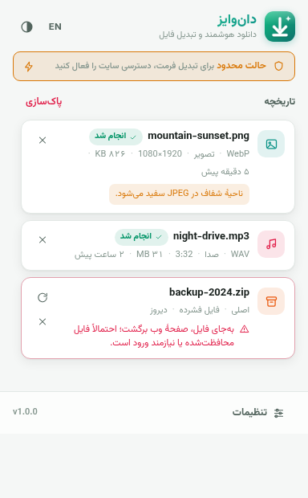
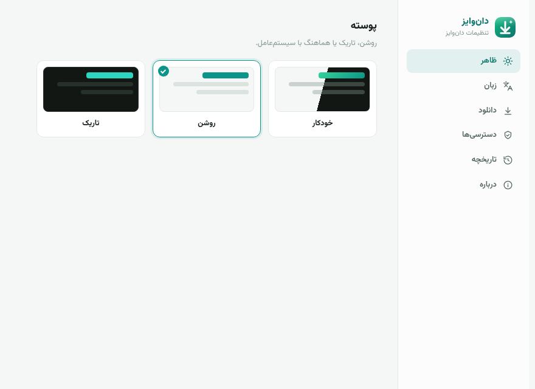
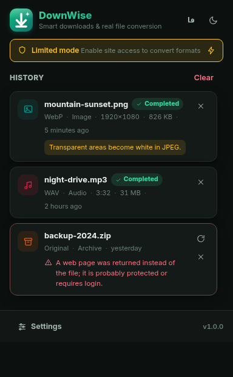
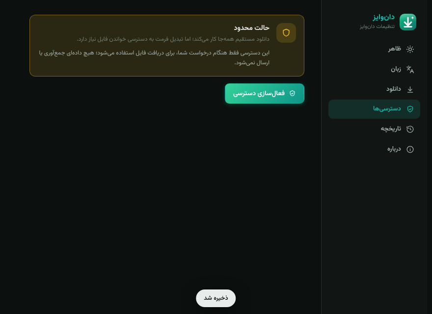

<div align="center">


# DownWise

**دان‌وایز** — Smart right-click downloads with **real** format conversion for Chrome (Manifest V3). فارسی / English.

[](https://github.com/SamRonin/downwise/actions/workflows/ci.yml)
[](LICENSE)
[](manifest.json)
[](CONTRIBUTING.md)

</div>

---

<div align="center">

| Popup (فارسی · light) | Options (فارسی · light) |
|:---:|:---:|
|  |  |
| **Popup (English · dark)** | **Permissions (فارسی · dark)** |
|  |  |

*Right-click menu, live job progress, instant settings — all local, all honest.*

</div>

## ✨ Features

- **Smart context menu** — right-click any image, video, audio element or link and pick
  *Download original file* (smart-probed and type-enriched), or a real conversion target
  (*Download as PNG/JPEG/WebP* on images, *Download as WAV* on audio). The menu speaks your
  language and rebuilds itself when you switch.
- **Real conversions, no fakery** — every offered output is genuinely produced by Chromium's own
  codecs or by DownWise's own encoder. A renamed file is not a conversion; DownWise never does that.
- **HTML-response detection + smart recovery** — hotlink protection and login walls often answer
  with a *web page* instead of the file. DownWise sniffs every response (headers **and** magic
  bytes), refuses to save garbage, then looks inside the page you clicked in for better candidates
  (`data-*` full-size attributes, `srcset`, `<picture>/<source>` variants, `og:image`,
  `twitter:image`, direct-download `<a href>` links) and retries automatically.
- **Progress & status everywhere** — byte-accurate progress bars in the popup, live status badges
  (queued → fetching → converting → saving → done), a toolbar badge with the active-job count and
  ✓/! flashes, and desktop notifications you can turn off.
- **فارسی & English, RTL & LTR** — a fully bilingual UI with runtime switching (no browser
  restart). Persian is the default and gets first-class RTL typography with the Vazirmatn font;
  English uses Inter. Both directions are logical-property driven, not mirrored hacks.
- **Dark / light / auto theme** — follows your OS or is pinned with one click, in both languages.
- **Local-only privacy** — no analytics, no accounts, no telemetry, no remote code. Your history
  lives in `chrome.storage.local` on your machine. See [docs/PRIVACY.md](docs/PRIVACY.md).

## 🎯 What converts into what — honestly

DownWise's [conversion registry](src/converters/registry.js) is the single source of truth, and it
only lists formats a real encoder exists for:

| Input (sniffed, not guessed) | Possible outputs |
|:---|:---|
| **Image** — PNG, JPEG, WebP, AVIF, GIF, BMP, ICO, SVG (rasterized), HEIC where Chromium decodes it | **PNG · JPEG · WebP** (quality slider applies to JPEG/WebP; SVG is rasterized with sane sizing) — or the original |
| **Audio** — MP3, WAV, OGG/Opus, FLAC, AAC/M4A, or the audio track of MP4/WebM containers | **WAV** (16-bit PCM, decoded via Web Audio) — or the original |
| **Video, documents (PDF/Office/EPUB…), archives (ZIP/RAR/7z…)** | **Original only** — saving the file untouched is the honest move |

### What DownWise deliberately does NOT do

- **No AVIF, SVG or MP3 *encoding*.** Chromium ships no canvas or media encoder for these, and
  DownWise refuses to ship a renamed file and call it a conversion.
- **No video transcoding.** That would mean bundling ffmpeg (tens of megabytes, a build step, and
  a huge attack surface) — incompatible with this project's no-build, no-remote-code stance.
- **No HLS (`m3u8`), DASH (`mpd`) or MSE streams.** Segment playlists cannot be merged into a
  playable media file without remuxing; `blob:` MediaSource URLs cannot be re-fetched at all.
  DownWise detects them and tells you plainly instead of producing a broken file.
- **Size caps:** a hard **250 MB** limit per fetched file (the payload is buffered in memory),
  **30 MB** for image conversions and **45 MB** for audio conversions (results cross an internal
  base64 bridge). Larger files can still be downloaded as *originals* — within the 250 MB cap.
- **Animated images:** only the first frame is rasterized. The UI tells you when that happened.

## 📦 Install

### Chrome Web Store

_Coming soon._ Until then, install manually — it takes about a minute.

### Manual install (unpacked)

Requires **Chrome 116 or newer** (also works in Edge, Brave and other Chromium browsers of that
generation). 116 is where `chrome.runtime.getContexts` and the full `chrome.offscreen` API landed —
both are needed for SVG rasterization and audio conversion.

1. Download the source: `git clone https://github.com/SamRonin/downwise.git` (or download & unzip the
   release archive).
2. Open `chrome://extensions` in Chrome.
3. Toggle **Developer mode** (top-right).
4. Click **Load unpacked** and select the `downwise` folder.
5. Pin DownWise to the toolbar. Done — right-click any file and look for
   *“دان‌وایز — دانلود هوشمند”* / *“DownWise — Smart Download”*.

For troubleshooting (missing menu, failed conversions, corporate networks) see
[docs/INSTALL.md](docs/INSTALL.md) — also available in
[Persian](docs/INSTALL.fa.md).

## 🔐 Permissions, explained

DownWise asks for as little as possible and explains every piece:

| Permission | Why it's needed |
|:---|:---|
| `contextMenus` | Builds the right-click “DownWise — Smart Download” menu. |
| `downloads` | Saves files via `chrome.downloads`, tracks completion, powers “Show in folder”. |
| `storage` | Settings (synced) and your job history (kept **local**). |
| `scripting` + `activeTab` | Temporarily runs the recovery helper **inside the tab you clicked in** — only at your gesture — to find better file URLs or fetch `blob:` URLs. |
| `notifications` | Optional “download complete / failed” toasts (disable anytime in Settings). |
| **Site access** `*://*/*` *(optional)* | **Never requested at install time.** Direct/original downloads work without it. It is only needed for **format conversion**, because the extension's own fetch must bypass CORS to read the file. Grant or revoke it anytime from the popup or Settings — one click, instantly effective. Nothing is ever collected or transmitted. |

## 🚀 Development

```bash
# prerequisites: Node.js 18+, and bun (or npm) as your package runner
bun install          # install dev dependencies (eslint)
bun run test         # 45 unit tests via `node --test` (pure modules: mime, sniff, wav, i18n…)
bun run lint         # eslint (flat config)
```

With npm instead: `npm install`, `npm test`, `npm run lint`.

There is **no build step** — the extension is vanilla ES modules loaded straight from the source
tree. Load it unpacked (see above) and reload after edits.

```
downwise/
├── manifest.json          # MV3 manifest (Chrome 116+, fa/en locales)
├── _locales/              # Store-facing name & description (fa/en)
├── assets/
│   ├── fonts/             # Vazirmatn + Inter (variable woff2, OFL)
│   └── icons/             # 16 → 512 px PNG icons
├── src/
│   ├── background/        # Service worker: menu, fetcher, recovery, pipeline, offscreen host
│   ├── converters/        # Registry + image/audio/WAV converters (pure + DOM paths)
│   ├── lib/               # mime, sniff, filename, settings, jobs, errors, branding, base64
│   ├── i18n/              # fa/en dictionaries + runtime switching engine
│   ├── ui/                # popup, options, grant page (HTML/CSS/JS)
│   └── offscreen/         # Offscreen document: SVG raster, audio decode, blob URLs
├── tests/                 # 45 Node tests (node --test)
└── docs/                  # ARCHITECTURE, INSTALL, PRIVACY + screenshots
```

A guided tour of the data flow, messaging protocol and storage schema lives in
[docs/ARCHITECTURE.md](docs/ARCHITECTURE.md).

## 🌍 Localization

DownWise ships its own dictionaries because `chrome.i18n` cannot switch language at runtime — and
switching live is a feature. Adding a language:

1. Copy `src/i18n/en.js` to `src/i18n/<code>.js` and translate the **values** (keep the keys, and
   the `{placeholders}`).
2. Register it in `src/i18n/index.js`: add it to `DICTS` and `LANGUAGES` (set `meta.dir` to
   `rtl` or `ltr`).
3. Add the store-facing `extName` / `extDesc` in `_locales/<code>/messages.json`.
4. Run `bun run test` — the **parity test** fails if your dictionary is missing keys compared to
   `fa.js` / `en.js`, so translations can't silently drift.
5. If the new language is RTL, check `src/ui/*.css` — layout uses logical properties, so it should
   mostly “just work”.

## 🤝 Contributing & Security

Contributions are welcome! Please read [CONTRIBUTING.md](CONTRIBUTING.md) (نسخهٔ فارسی:
[CONTRIBUTING.fa.md](CONTRIBUTING.fa.md)) for setup, code style and the PR process.

Found a security issue? Please report it privately — see
[SECURITY.md](SECURITY.md). Do not open public issues for vulnerabilities.

## 📄 License

Released under the [MIT License](LICENSE).

The bundled typefaces are licensed under the SIL Open Font License: **Vazirmatn** (fa) and
**Inter** (en) — see `assets/fonts/` for their license texts. ♥
